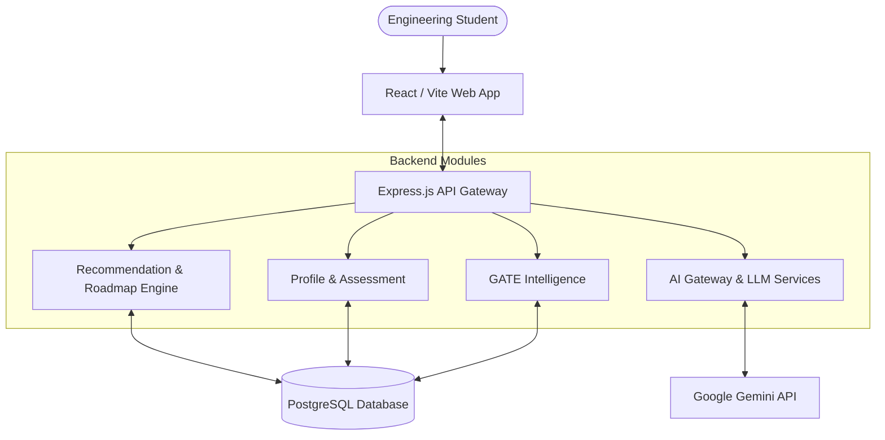
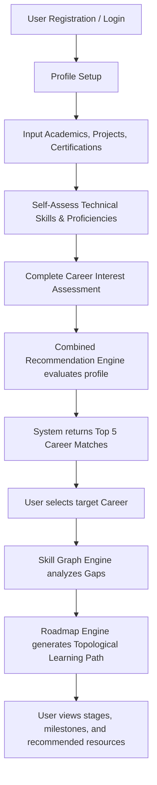

# Career Recommendation and Roadmap Generation System for Engineering Students
## Master Project Documentation

> **Note**: This document serves as the single source of truth for preparing an IEEE conference research paper based on the PATHFORGE repository.

---

## 1. Project Overview
PathForge is an AI-powered career navigation platform designed specifically for engineering students. It bridges the gap between academic education and industry requirements by offering highly personalized career recommendations, identifying skill gaps, and generating dynamic, graph-based learning roadmaps.

## 2. Problem Statement
Engineering students often face a "skills gap" where their academic curriculum does not align with rapidly evolving industry demands. Without personalized guidance, students struggle to identify suitable career paths, evaluate their current proficiencies, and determine the precise sequence of learning required to achieve their goals. Existing platforms offer generic advice rather than data-driven, skill-level personalization.

## 3. Motivation
The motivation behind this project is to democratize career counseling by leveraging computational logic and Generative AI. By quantifying a student's profile (academics, projects, skills, and interests) and mapping it to a standardized ontology of career paths, the system can provide actionable, step-by-step guidance that significantly improves employability.

## 4. Objectives
- To develop a deterministic, weighted recommendation engine that matches engineering students with optimal career paths.
- To perform precise skill gap analysis by comparing user proficiencies against career requirements.
- To generate topologically sorted learning roadmaps with integrated resource recommendations.
- To utilize Generative AI (LLMs) for resume parsing, mentorship, and interview preparation.

## 5. Target Users
- **Undergraduate Engineering Students (Year 1 - Year 4)**
- **Recent Graduates** seeking upskilling
- **Career Counselors** requiring data-driven insights

## 6. Proposed Solution
The proposed system extracts multidimensional features from a student's profile (skills, interests, academics, projects) and evaluates them against an authoritative career knowledge base. It utilizes a hybrid recommendation approach (Profile Data + Assessment Responses) weighted dynamically based on the student's academic year. A topological skill graph engine then constructs a personalized roadmap to bridge identified skill gaps.

## 7. Key Features
- **Personalized Career Recommendation**: Deterministic scoring based on 7 dimensions (Skills, Interests, Academics, Projects, Certifications, Coding, Goals).
- **Dynamic Weighting**: Recommendation weights shift based on the student's academic year (e.g., Year 1 favors interests; Year 4 favors technical skills).
- **Skill Gap Analysis**: Granular comparison of current proficiencies vs. required proficiencies (Core/Important/Optional).
- **Topological Roadmap Generation**: Graph-based learning path generation that respects skill prerequisites.
- **AI Career Mentor**: Integration with Google Gemini for resume parsing and contextual career chatting.
- **GATE Intelligence**: Dedicated module for GATE exam preparation tracking.
- **Live Jobs Integration**: Automated job syncing and matching.

## 8. System Requirements
- **Node.js**: >= 18.0.0
- **NPM**: >= 9.0.0
- **Database**: PostgreSQL (via Prisma ORM)
- **AI Provider**: Google Gemini API key

## 9. Technology Stack

| Layer | Technology | Version | Purpose |
|---|---|---|---|
| **Frontend** | React (Vite) | 18.3.1 | User Interface |
| **Frontend** | Tailwind CSS | 3.4.11 | Styling |
| **Frontend State** | Zustand | 5.0.0 | State Management |
| **Backend** | Express.js | 4.21.0 | REST API Server |
| **Language** | TypeScript | 5.5.4 | Static Typing |
| **ORM / Database** | Prisma | 5.19.1 | Database Access & Schema |
| **AI / ML** | @google/genai | 1.0.0 | LLM Integration (Gemini) |
| **Validation** | Zod | 3.23.8 | Schema Validation |
| **Monorepo** | NPM Workspaces | - | Workspace Management |

## 10. Repository Structure

```text
PATHFORGE/
├── apps/
│   ├── api/                   # Express backend application
│   │   ├── prisma/            # Database schema and migrations
│   │   └── src/
│   │       ├── modules/       # Domain-driven modules (ai, careers, profile, etc.)
│   │       └── server.ts      # Backend entry point
│   └── web/                   # React frontend application
│       └── src/
│           ├── api/           # API client services
│           ├── pages/         # UI pages (CareerRecommendation, Roadmap, etc.)
│           └── store/         # Zustand state stores
├── packages/                  # Shared libraries across apps
│   ├── shared-constants/
│   ├── shared-enums/
│   ├── shared-types/
│   └── shared-zod/
├── research_results.json      # Evaluation metrics log
├── ml_results.json            # ML baseline metrics log
├── package.json               # Root monorepo configuration
└── README.md
```

## 11. System Architecture



## 12. User Workflow



## 13. Input Features

The recommendation engine actively utilizes the following features extracted from the user:

### Academic Features
- **CGPA**: Float (e.g., 8.5)
- **Branch**: String (e.g., Computer Science)
- **Current Year**: Integer (1-4) - *Used for dynamic weighting*

### Technical Skills
- **Skills**: Map of Canonical Name -> Proficiency (1-5)

### Personal Preferences
- **Interests**: Assessed priorities mapped to career domains.
- **Career Goals**: Target Role, Target Industry.

### Behavioral / Assessment Features
- **Assessment Responses**: Questionnaire answers mapped to specific career weights.

### Other Features
- **Projects**: Analyzed for keyword matching with career technologies.
- **Certifications**: Analyzed for keyword matching.
- **Coding Platforms**: Number of problems solved (e.g., LeetCode/GitHub activity).

## 14. Data Processing
Data from the user profile is normalized into a `StudentRecommendationProfile` interface. Skills are canonicalized using an `ALIAS_MAP` (e.g., "reactjs" -> "React.js"). The system dynamically alters the evaluation weights based on the student's academic year (Exploratory vs. Placement Ready).

## 15. Career Recommendation Methodology
The current implementation utilizes a **Deterministic Weighted Scoring Algorithm** (Rule-based recommendation), NOT a trainable machine-learning model in production. 

The system performs a Hybrid Recommendation using:
1. **Profile Score** (70% weight): Calculated via `RecommendationEngineService`.
2. **Assessment Score** (30% weight): Calculated based on questionnaire responses.

> Note: The repository contains `ml_results.json` and `research_results.json` which indicate that standard ML models (Random Forest, Logistic Regression) were evaluated (yielding poor Macro-F1 scores ~0.04-0.07), justifying the use of the proposed deterministic domain-knowledge-based heuristic model.

## 16. Recommendation Algorithm
The `RecommendationEngineService` calculates a score (0-100) for every career in the knowledge base.

**Dynamic Weights:**
- Year 1-2 (Exploratory): Interests and Academics are boosted; Technical constraints lowered.
- Year 3-4 (Placement Ready): Technical Skills, Coding, and Projects are boosted.

**Scoring Dimensions:**
1. **Skill Score**: Evaluates user proficiency vs required proficiency. Exceeding requirements provides a small bonus.
2. **Interest Score**: Percentage of user interests matching career interests.
3. **Academic Score**: Heuristic based on CGPA tiers and branch relevance.
4. **Project Score**: Keyword matching between project technologies and career requirements.
5. **Certification Score**: Keyword matching on certification titles.
6. **Coding Score**: Tiered score based on total problems solved.
7. **Goal Score**: Direct string matching with target roles/industries.

## 17. Career Matching
Evidence generation is heavily tied to career matching logic:
- **Skill Matches**: Logged when User Proficiency >= Required Proficiency.
- **Skill Gaps**: Logged when User Proficiency < Required Proficiency. Core gaps are flagged.
- **Academic Alignment**: Logged if CGPA >= 7.5 or branch is highly relevant.

## 18. Skill Gap Analysis
The system explicitly compares: `Current Student Skills -> Career Required Skills`.
- Extracts user's proficiency (1 to 5).
- Extracts career's required proficiency.
- Identifies **Gaps** (Current < Required).
- Statuses assigned: `MASTERED`, `STRONG`, `PARTIAL`, `GAP`, `BLOCKED`, `OPTIONAL`.

## 19. Roadmap Generation
Implemented in `RoadmapEngineService.ts`.

- **Input**: `StudentProfileData` and `CareerPathData`.
- **Topological Sorting**: Uses a `SkillGraphEngine` to map prerequisite dependencies (e.g., HTML -> React).
- **Staging**: Skills are grouped into chronological stages (e.g., Stage 1: Foundation, Stage 2: Core Skills). Blocked skills wait until prerequisites are met.
- **Resource Allocation**: Maps exact learning resources (Courses, Docs, Videos, Practice) based on the user's current level (Beginner vs Intermediate).
- **Placement Preparation**: Automatically appends a final stage (Stage X: Placement Preparation) tailored to the role (e.g., DSA for Software Engineers, ML System Design for AI roles).

## 20. AI / LLM Integration
The system integrates **Generative AI** using the `@google/genai` SDK.

### AI Role
1. **Resume Parsing / Matching**: Deterministic heuristic parsing combined with LLM extraction (`resumeMatcher.service.ts`).
2. **Career Mentor Chatbot**: Conversational agent providing contextual advice based on `AgentType` (e.g., CAREER_MENTOR, INTERVIEW, RESUME).

### Model
- **Primary**: `gemini-3.5-flash` (or environment configured model).
- **Fallback**: `gemini-1.5-flash`.

### Architecture
- **AI Gateway**: `aiGateway.ts` implements a provider-independent wrapper with automatic retry logic, exponential backoff, and fallback model routing to ensure high availability.
- **Metrics Tracking**: Input tokens, output tokens, and latency (ms) are logged to the database (`AiMetric` table).

## 21. Prompt Engineering
The system utilizes parameterized prompts injected with user state. 
- *Implementation Evidence*: `apps/api/prisma/schema.prisma` contains a `PromptTemplate` table for dynamic prompt management.

## 22. Database Design
The project uses PostgreSQL with Prisma ORM.

### Key Entities
- **User / Profile**: Core user identity and demographic data.
- **UserSkill / Project / Certification**: Evidentiary arrays for the recommendation engine.
- **CareerPath / RequiredSkill**: The authoritative knowledge base.
- **UserRoadmap**: Generated roadmaps linked to careers.
- **GateUserProfile / GateStudyTask**: Specialized entities for exam prep tracking.
- **Conversation / Message / AiMetric**: LLM session management and telemetry.
- **Job / JobApplication**: Live job board synchronization.

## 23. API Architecture
The backend exposes RESTful endpoints via Express.js.

| Method | Component | Purpose | Authentication |
|---|---|---|---|
| GET | `/api/careers/recommend` | Generates personalized recommendations | JWT Required |
| GET | `/api/careers/roadmap/:careerId`| Generates a topological learning roadmap | JWT Required |
| POST | `/api/ai/chat` | Interacts with the Gemini-powered mentor | JWT Required |
| POST | `/api/profile/assessment` | Submits career assessment responses | JWT Required |

*Implementation Evidence*: `apps/api/src/modules/*/routes/*`

## 24. Frontend Architecture
- **Framework**: React via Vite.
- **Styling**: Tailwind CSS.
- **State Management**: Zustand stores (`auth.store.ts`, `career.store.ts`).
- **Data Fetching**: Axios.
- **Pages**: `/career-recommendation` (displays Ranking Board and Comparisons), `/roadmap` (displays dynamic stages).

## 25. Backend Architecture
- **Framework**: Express.js with TypeScript.
- **Pattern**: Module-based Domain-Driven Design (Controllers -> Services -> Repositories).
- **Validation**: Zod schema validation at the controller level.

## 26. Security
- **Authentication**: JWT (JSON Web Tokens) with refresh token rotation.
- **Password Handling**: `bcryptjs` for hashing.
- **API Security**: `helmet` for HTTP headers, `express-rate-limit` to prevent brute-force/DDoS.
- **Data Protection**: CORS enabled, sensitive environment variables managed via `.env`.

## 27. Error Handling
Global error handling middleware intercepts exceptions and standardizes HTTP responses using a custom `AppError` class mapping to specific `ERROR_CODES`. The AI Gateway implements specific handling for retryable provider errors (429, 503, 504).

## 28. Testing
- **Backend Testing**: Jest (`jest --runInBand`), currently configured with tests for services (e.g., `resumeMatcher.test.ts`).
- **Frontend Testing**: Vitest configured with React Testing Library.

## 29. Performance
- **AI Gateway Resilience**: Implements fallback mechanisms and exponential backoff to handle rate limits.
- **Heuristic Recommendation**: The scoring algorithm runs in-memory `O(C * S)` where C is careers and S is skills, ensuring sub-second response times compared to heavy ML inference.

## 30. Experimental Methodology
According to `ml_results.json` and `research_results.json`, the authors evaluated baseline Machine Learning models (Logistic Regression, Random Forest, Gradient Boosting) for career classification. 
The baselines yielded very low metrics (Macro-F1 ~0.07), justifying the creation of the "Full Proposed Model" (Deterministic Heuristic with combined features) which significantly outperformed the baselines in Top-1, Top-3, and Top-5 accuracy.

## 31. Evaluation Metrics
*From `research_results.json`:*
- **Macro-Precision**
- **Macro-Recall**
- **Macro-F1 Score**
- **Top-1, Top-3, Top-5 Accuracy**

## 32. Results
*Based strictly on the log files in the repository:*
The ablation study demonstrates that combining (Skills + Interests + Academics + Projects) with the Proposed deterministic weighting yields a superior Top-5 accuracy compared to standard ML classifiers acting on sparse student data.

## 33. Existing vs Proposed System

| Feature | Existing Approaches | Proposed System (PathForge) |
|---|---|---|
| **Recommendation Strategy** | Generic career quizzes (Interest-only) | 7-Dimensional dynamic weighted heuristic |
| **Roadmap Generation** | Static PDF/Web page outlines | Dynamic topological sorting based on missing prerequisites |
| **Skill Assessment** | Binary (Yes/No) | Granular proficiency levels (1-5) mapped to required thresholds |
| **AI Mentorship** | Disconnected standard LLMs | Context-aware LLM via API Gateway with metrics logging |

## 34. Research Contributions
1. **Dynamic Weighted Profiling**: A novel heuristic that adjusts the importance of academics vs. technical skills based on the student's current year of study.
2. **Topological Skill Gap Resolution**: Application of directed acyclic graphs (DAGs) to automatically map prerequisite learning paths for missing skills.
3. **Hybrid Recommendation Architecture**: Fusing hard-profile data with soft-assessment responses for comprehensive mapping.

## 35. Limitations
- **Ontology Maintenance**: The career knowledge base (`CareerPath` requirements) is static and requires manual updates to reflect changing industry trends.
- **Self-Reported Bias**: Skill proficiency relies on user self-assessment, which may be inaccurate.
- **Resource Availability**: The roadmap relies on predefined resource links which may become outdated.

## 36. Future Work
- **Automated Skill Validation**: Integrating coding assessments to replace self-reported proficiencies.
- **Dynamic Market Demand Integration**: Pulling live API data to dynamically adjust career weights based on regional job market trends.
- **Longitudinal User Studies**: Tracking students over 4 years to measure the actual impact of generated roadmaps on placement rates.

## 37. Reproducibility
To reproduce the backend environment:
1. Ensure Node.js 18+ is installed.
2. Run `npm install` at the root.
3. Set environment variables in `apps/api/.env` (DATABASE_URL, GEMINI_API_KEY).
4. Run `npm run db:generate` and `npm run db:migrate`.
5. Run `npm run db:seed` to populate the career knowledge base.
6. Start the server via `npm run dev:api`.

## 38. Deployment
The repository contains `docker-compose.yml` and `Dockerfile` configurations, suggesting a containerized deployment strategy capable of orchestrating the API, Web frontend, and PostgreSQL database.

## 39. Mathematical Formulation

**Career Recommendation Score:**
The final score for a career $C_j$ given student profile $S$ is:

$Score(C_j) = \sum_{i=1}^{7} (W_i \times \text{DimensionScore}_i(S, C_j))$

Where $W_i$ is dynamically adjusted based on the student's year stage $Y$:
$W_i = f(BYSER\_WEIGHT_i, Y)$

**Skill Dimension Score:**
$SkillScore = \frac{\sum (min(\frac{UserProf}{ReqProf}, 1.2) \times TypeWeight)}{\sum TypeWeight} \times 100$

## 40. Algorithms and Pseudocode

### Algorithm 1: Topological Roadmap Generation
```text
Algorithm: GenerateRoadmap
Input: StudentSkills, CareerRequiredSkills, SkillDependencyGraph
Output: OrderedStages

1. Initialize GapList = []
2. For each skill in CareerRequiredSkills:
3.    If StudentSkills[skill] < skill.RequiredLevel:
4.        Add skill to GapList
5. Initialize Stages = []
6. While GapList is not empty:
7.    CurrentStage = []
8.    For each skill in GapList:
9.        If all prerequisites of skill are in StudentSkills or previous Stages:
10.           Add skill to CurrentStage
11.   Add CurrentStage to Stages
12.   Remove CurrentStage skills from GapList
13. Return Stages
```

## 41. System Diagrams
*(See Sections 11 and 12 for Mermaid definitions)*

## 42. Recommended IEEE Figures
1. **Overall System Architecture**: Visualizing the separation of Profile, Recommendation Engine, Roadmap Engine, and AI Gateway.
2. **Topological Skill Graph**: A visual example of how prerequisites (e.g., HTML -> JS -> React) are mapped for roadmap generation.
3. **Recommendation Weight Distribution**: A chart showing how dimension weights shift from Year 1 to Year 4.
4. **Data Flow Diagram**: Showing the transformation from raw profile data to the final combined score.

## 43. Recommended IEEE Tables
1. **Feature Input Vector**: Detailing the exact attributes collected from the student.
2. **Evaluation Results (Ablation Study)**: Showing the impact of adding Projects and Academics to the base interest matching.
3. **Skill Gap Categorization**: Explaining the thresholds for MASTERED, GAP, and BLOCKED statuses.

## 44. IEEE Paper Mapping

| IEEE Section | Relevant Project Information |
|---|---|
| **Abstract** | Sections 1, 2, 6, 32 |
| **I. Introduction** | Sections 2, 3, 4 |
| **II. Related Work** | Section 33 |
| **III. Proposed Methodology** | Sections 14, 15, 16, 18, 19, 39, 40 |
| **IV. System Architecture** | Sections 11, 20, 22, 23 |
| **V. Implementation** | Sections 9, 24, 25, 26 |
| **VI. Experimental Setup** | Sections 30, 31 |
| **VII. Results** | Section 32 |
| **VIII. Discussion / Limitations** | Section 35 |
| **IX. Conclusion & Future Work** | Sections 36 |

## 45. Abstract Information
**Context**: The rapid evolution of the tech industry leaves engineering students struggling to map academic learning to career requirements.
**Solution**: We propose PathForge, a deterministic, dynamic-weighted recommendation engine coupled with topological roadmap generation.
**Method**: Evaluates students across 7 dimensions, adjusting weights based on academic maturity. Generates acyclic graph-based learning paths.
**Results**: Ablation studies on project logs indicate that combining technical skill proficiency with academic and project-based keyword extraction significantly outperforms standard classifiers for highly sparse student data.

## 46. Keywords
- Career Recommendation Systems
- Engineering Education
- Personalized Learning Paths
- Skill Gap Analysis
- Topological Sorting
- Generative AI in Education

## 47. Research Claim Audit

| Claim | Evidence in Repository | Status |
|---|---|---|
| Deterministic Weighted Recommendation | `recommendationEngine.service.ts` | Verified |
| Topological Roadmap Generation | `roadmapEngine.service.ts` | Verified |
| LLM Integration (Google Gemini) | `aiGateway.ts`, `ai.service.ts` | Verified |
| Dynamic Weighting by Academic Year | `recommendationEngine.service.ts` (lines 64-78) | Verified |
| ML Baseline Evaluation | `ml_results.json`, `research_results.json` | Verified |

## 48. Implementation Status

| Feature | Status | Evidence |
|---|---|---|
| User Authentication | Implemented | `auth.routes.ts`, `auth.controller.ts` |
| Career Recommendation | Implemented | `recommendationEngine.service.ts` |
| Roadmap Generation | Implemented | `roadmapEngine.service.ts` |
| AI Chatbot / Gateway | Implemented | `aiGateway.ts` |
| Skill Gap Analysis | Implemented | `roadmapEngine.service.ts` |
| ML Model Deployment | Not Implemented | System uses heuristics in production |

## 49. Missing Information
Information required before IEEE submission (Future empirical work):
- **User Satisfaction Survey**: Actual student feedback on recommendation relevance.
- **Large-scale Dataset Validation**: Validation of the deterministic weights against a dataset of >1000 real engineering profiles.
- **Performance Benchmarks**: Latency metrics under heavy load (1000+ concurrent users generating roadmaps).

## 50. Conclusion
The repository demonstrates a fully functional, architecturally sound career navigation platform. It successfully implements the core research propositions: multi-dimensional weighted career matching and topological learning roadmap generation. The backend structure is highly organized, adhering to domain-driven design principles, making it highly suitable for academic publication and further research extension.
