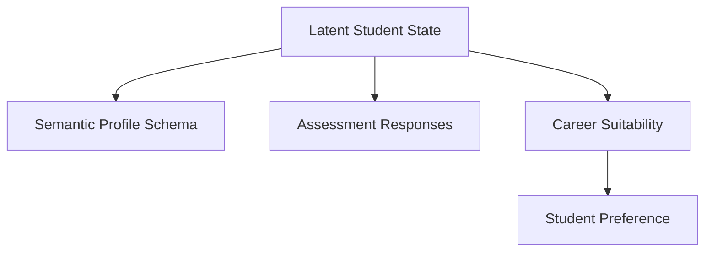

# PATHFORGE Semantic Benchmark Generator Design (v3)

## 1. Objective
To generate `synthetic_v3`, a dataset that preserves the mathematically rigorous latent causal structure of `synthetic_v2` (avoiding target leakage) while outputting semantic features strictly compliant with the actual `StudentRecommendationProfile` schema, allowing PATHFORGE to natively ingest and evaluate it.

## 2. Generative DAG

## 3. Semantic Profile Generation (The Mapping)
Instead of linear continuous mappings to `profile_dim_1`, $LV$ maps to probabilities of holding discrete semantic skills, projects, and keywords.

- **Skills:** 
  The mapping matrix $M_{Skill}$ evaluates $\text{sigmoid}(LV \cdot M_{Skill}) > \text{Threshold}$ to grant a canonical skill (e.g., `SK_python`, `SK_react`). The proficiency is also sampled around the mapped magnitude.
- **Projects & Certifications:** 
  Similarly, $LV$ projects onto the probability of generating a project/cert containing specific canonical technologies or domain keywords.
- **Academics:** 
  $LV$ maps to expected CGPA. $LV$ dimensions associated with CS/IT map to a high probability of having branch `"Computer Science"`.
- **Coding Evidence:**
  $LV$ maps to the Poisson lambda parameter for `totalProblemsSolved`.
- **Career Goals:**
  $LV$ maps to probabilities of targeting specific industries or roles.

**CRITICAL LEAKAGE RULE:** `career_suitability` is computed *in parallel* from $LV$. The label `career_suitability` is never used to look up required skills in the catalog to force matches. All correlation arises purely because $LV \cdot M_{Skill}$ aligns with $LV \cdot W_c$.

## 4. Assessment Generation
Remains identical to `synthetic_v2`. $LV$ is projected via $M_{Assessment}$ to generate 1-5 Likert responses, exactly aligned with the 20 PATHFORGE questions.

## 5. Three Information Conditions
- **Condition A (Profile-dominant):** $M_{Skill}$ and $M_{Academic}$ have high variance and strong alignment with $W_c$. $M_{Assessment}$ maps mostly to noise dimensions.
- **Condition B (Complementary):** $M_{Skill}$ aligns with the first half of the latent dimensions. $M_{Assessment}$ aligns with the second half. This mathematically guarantees complementarity without direct target conditioning.
- **Condition C (Assessment-dominant):** $M_{Assessment}$ aligns strongly with $W_c$, while $M_{Skill}$ is highly stochastic (e.g., all students have generic skills).

## 6. Benchmark Validation Requirements
Before evaluating PATHFORGE, the `synthetic_v3` benchmark must pass the following empirical checks:
1. **Schema Validity:** The output JSON must successfully parse through `StudentRecommendationProfile` without throwing type or missing key errors.
2. **Leakage Audit:** Automated checks ensure the `career_suitability` variable is never passed into the functions generating the Profile or Assessment fields.
3. **Information Structure (Oracle Checks):** 
   - A Latent-state oracle achieves ~100% accuracy.
   - Profile-only observable model (using NLP or One-Hot encoded skills) accurately predicts Condition A.
   - Assessment-only observable model accurately predicts Condition C.
   - Combined observable model shows statistically significant gain over individual models in Condition B.
   - Class frequencies remain between 4% and 9%.
