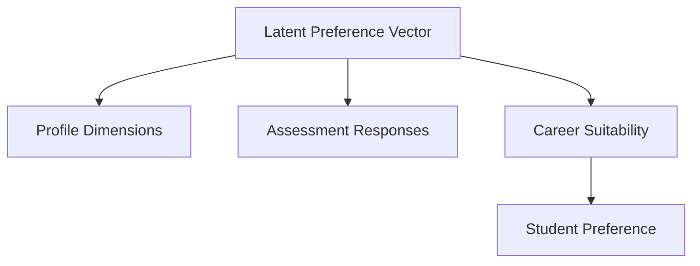

# PATHFORGE Synthetic Dataset Generator Specification (v1)

**Status:** CONTROLLED SYNTHETIC BENCHMARK (DESIGN)
**WARNING:** This document describes a fully synthetic generation process. It does NOT represent real student evidence, human validation, or real-world effectiveness.

## 1. Causal Generative DAG

To prevent target leakage and circular generation, the generator strictly follows this causal Directed Acyclic Graph (DAG):

*Note: The target label for the recommendation engine evaluation is `Career Suitability` (`CS`). `Student Preference` (`SP`) is generated as a noisy proxy.*

## 2. Transparent Generative Process

### A. Latent Preference Vector (`LV`)
- **Source:** Random initialization.
- **Distribution:** $LV \sim \mathcal{N}(0, I)$ where $LV \in \mathbb{R}^k$ ($k=15$, representing abstract orthogonal traits like logical reasoning, creative drive, etc.).
- **Dependencies:** None.
- **Random Seed:** 42 (Master generation seed).

### B. Career Suitability (`CS`)
- **Source:** Latent Preference Vector (`LV`).
- **Distribution:** For each career $c$, suitability score $S_c = LV \cdot W_c + \epsilon_{cs}$, where $\epsilon_{cs} \sim \mathcal{N}(0, \sigma_{cs}^2)$.
- **Target Extraction:** `career_suitability` $= \arg\max_c (S_c)$.
- **Dependencies:** `LV`.
- **Career-Specific Parameters:** $W_c \in \mathbb{R}^k$, generated uniformly on the unit hypersphere with seed 101.

### C. Profile Dimensions (`P`)
- **Source:** Latent Preference Vector (`LV`).
- **Distribution:** Profile features $P_i = LV \cdot M_{P,i} + \epsilon_P$, where $M_{P,i}$ maps latent traits to observable skills/academics. Discretized or thresholded to match profile schemas (e.g., skill proficiency 0-100).
- **Dependencies:** `LV`.
- **Conditional Generation:** No. Generated directly from the latent vector, not from the target class.

### D. Assessment Responses (`A`)
- **Source:** Latent Preference Vector (`LV`).
- **Distribution:** Assessment question $A_j = \text{round}(\text{clip}(\mu_j + LV \cdot M_{A,j} + \epsilon_A, 1, 5))$.
- **Dependencies:** `LV`.
- **Conditional Generation:** No. Likert responses generated purely from the latent vector, avoiding direct dependence on `career_suitability`.

### E. Student Preference (`SP`)
- **Source:** Career Suitability (`CS`).
- **Distribution:** `student_preference` is assigned by taking `career_suitability` and applying a label-noise transition matrix $T_{SP}$ (e.g., biased towards high-salary careers).

## 3. Parameter Controls for Multiple Conditions

The condition is dictated by the signal-to-noise ratios (variances $\epsilon_P$ and $\epsilon_A$) and the overlap of mapping matrices $M_P$ and $M_A$ with the career weight vectors $W_c$.

- **Condition A (Profile-dominant):** 
  - $\sigma_P^2$ is low (high signal).
  - $\sigma_A^2$ is high (high noise).
- **Condition B (Balanced):** 
  - $\sigma_P^2$ and $\sigma_A^2$ are equal and moderate. $M_P$ and $M_A$ capture orthogonal subspaces of $W_c$.
- **Condition C (Assessment-dominant):** 
  - $\sigma_P^2$ is high (high noise, generic profiles).
  - $\sigma_A^2$ is low (high signal).
